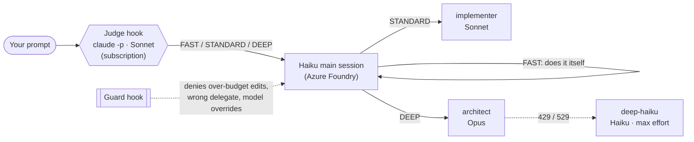

<div align="center">

# model-router

### Difficulty-based model routing for Claude Code

**Haiku does the easy work. A judge decides what is hard. Sonnet and Opus get the rest, and hooks enforce it.**

[](https://github.com/analienx/model-router/actions/workflows/ci.yml)
[](LICENSE)


[Quick start](#quick-start) · [How it works](#how-it-works) · [Proof](#proof-it-really-works) · [Setup guide](docs/SETUP.md) · [Changelog](CHANGELOG.md)

</div>

---

## Why

Running Claude Code on **Haiku** is fast and cheap, but Haiku is the weakest judge of when a task is too hard for it. Adding "use proactively" to an agent description is only a suggestion. And when you do escalate, **Sonnet and Opus are often rate-limited (429)**, so Claude Code waits minutes while it retries.

**model-router** turns "escalate when it's hard" into something you can rely on:

- A **stronger judge** (Sonnet, on your Claude subscription) rates every new prompt *before* Haiku sees it.
- **Hooks enforce the verdict.** Haiku can't make big edits itself, can't hand DEEP work to the wrong agent, and can't quietly downgrade a subagent's model.
- When the strong models are **throttled**, work falls back to Haiku at maximum effort, but only after a real 429/529.

## How it works



| Verdict | Who does the work | Model (your Foundry deployment) | Haiku may edit itself |
|---|---|---|---|
| **FAST** | the Haiku main session | `haiku` | up to 40 lines per prompt |
| **STANDARD** | `implementer` subagent | `sonnet` | up to 10 lines |
| **DEEP** | `architect` subagent | `opus` | nothing |
| *429/529 on the above* | `deep-haiku` subagent | `haiku`, max effort | - |

- **Judge chain:** your subscription's Sonnet, then Sonnet on Foundry, then local keyword rules. When the judge is unsure, the task goes to the stronger tier.
- **Shortcuts that skip the judge:**
  - start a prompt with `::fast`, `::standard` or `::deep` to choose the tier yourself;
  - "yes" or "continue" keeps the current tier;
  - "still failing" or "try again" moves up one tier.

Everything is **plain Python (standard library only) plus Claude Code's own hooks and agents**. It is active only when you start Claude Code with `claude-router`. Plain `claude` is untouched.

## Quick start

Requirements: Claude Code (2.1.327 tested), Python 3.8+, a Claude subscription login for the judge, and an Azure Foundry resource with Claude deployments.

```powershell
git clone https://github.com/analienx/model-router && cd model-router
python -m unittest discover -s tests      # optional: 78 self-tests, no network
python install.py install                 # hooks + agents + launcher, for your user
# edit ~/.claude-router/router.config.json: Foundry resource and deployment names
python install.py doctor                  # checks everything, explains every problem
python install.py test-judge              # one real judge call per backend
claude-router                             # after adding ~/.claude-router/bin to PATH
```

The **[setup guide](docs/SETUP.md)** walks through every step on Windows, macOS and Linux: Azure roles, deployment names, `az login`, configuration examples, troubleshooting and uninstall.

> **Read before installing at work:** the judge sends each prompt to Anthropic through your subscription, while the main session and subagents run on Azure. If your company requires Azure-only, remove the `subscription` step from the judge chain ([guide, section 2](docs/SETUP.md#2-read-this-before-installing-where-your-data-goes)).

## Proof it really works

Every push runs three kinds of checks in [GitHub Actions](https://github.com/analienx/model-router/actions/workflows/ci.yml):

| Job | What it proves |
|---|---|
| **Unit tests** (Linux, macOS, Windows · Python 3.8–3.14) | 78 tests of the hooks, judge chain, guard, launcher and installer, with a fake `claude`. They include 27 regression tests from a code review (24 of them fail on version 1.0.0) and 2 from the end-to-end run (both fail on 1.1.0). |
| **End-to-end** (Linux, macOS, Windows · real Claude Code) | Installs the router and runs the **real Claude Code CLI** through the `claude-router` launcher against a local mock of the Anthropic/Foundry API. No model, account or network is needed. The 24 checks are listed below. |
| **End-to-end vs. latest Claude Code** (weekly, informational) | The same test against the newest Claude Code release, as an early warning when Claude Code changes. |

What the end-to-end test verifies with the real Claude Code. Example from a local run on Linux with 2.1.327:

| Scenario | Check | Result |
|---|---|---|
| DEEP | The judge reached the **Sonnet deployment**, with `judge_system.md` instead of Claude Code's system prompt and no tools | PASS |
| DEEP | The main session ran on the **Haiku deployment**, and the hook injected the **DEEP directive** | PASS |
| DEEP | The guard **denied** Haiku's own 50-line `Write`; the file was not created | PASS |
| DEEP | The guard **denied** handing DEEP work to `implementer` | PASS |
| DEEP | `architect` ran on the **Opus deployment** and was allowed its 200-line `Write` | PASS |
| DEEP | The background-agent notification was **not re-judged** (exactly one judge call) | PASS |
| FAST | A 5-line `Write` was allowed; the next 100-line `Write` was **denied** (budget) | PASS |
| 429 fallback | Opus answered **HTTP 429**, and `deep-haiku` was allowed and did the work on the Haiku deployment | PASS |
| safety | Plain `claude` is untouched; with the router code deleted, Claude Code is **not blocked** | PASS |

The full report for each run is in the run summary, and the raw mock-API logs are under **Artifacts**. To run it yourself: `python tests/e2e/run_e2e.py` (see [CONTRIBUTING.md](CONTRIBUTING.md)).

**What is *not* proven automatically:** a real Foundry resource, a real subscription judge call (CI runners have no login, so the test asserts that this step fails cleanly), and real interactive use. Running `doctor`, `test-judge` and the first session ([guide, section 6](docs/SETUP.md#6-verify-the-installation)) covers those on your machine.

## Configuration at a glance

`~/.claude-router/router.config.json`. Every field is type-checked; if the file is invalid, routing switches off and Claude is told why.

```jsonc
{
  "foundry": { "resource": "my-foundry", "auth": "entra" },          // or api_key_env
  "tiers": {
    "fast":     { "model_id": "claude-haiku-5-5",  "deployment": "claude-haiku-5-5" },
    "standard": { "model_id": "claude-sonnet-5-5", "deployment": "team-sonnet" },  // modelOverrides automatic
    "deep":     { "model_id": "claude-opus-5-5",   "deployment": null }            // no Opus? DEEP -> Sonnet
  },
  "judge": {
    "chain": [
      { "backend": "subscription", "model": "sonnet", "effort": "max",  "timeout_s": 90 },
      { "backend": "foundry",      "model": "sonnet", "effort": "high", "timeout_s": 45 },
      { "backend": "rules" }
    ]
  },
  "guard": { "main_edit_budget": { "fast": 40, "standard": 10, "deep": 0 } }
}
```

All fields, with ready-made examples, are in [section 5 of the guide](docs/SETUP.md#5-configuration-reference-routerconfigjson).

## Tools included

| Command | Does |
|---|---|
| `python install.py install [--scope project --project DIR]` | Installs hooks, agents and launcher. Merges with your settings, backs them up, and keeps project files out of git. |
| `python install.py doctor` | Checks Python, config, Foundry auth, deployments, `claude`, hooks and agents, and explains every problem. |
| `python install.py test-judge` | Calls each judge in the chain once and prints the verdict, latency and errors. |
| `python install.py report --last 20` | Shows tier and source counts, judge latency, failures and recent decisions. |
| `claude-router --router-dry-run` | Prints the exact command and environment the launcher would use, with secrets masked. |
| `python install.py uninstall [--purge]` | Removes only the router's own hooks and agents, and never code another scope still uses. |

## Limits

These are stated plainly; details are in [section 12 of the guide](docs/SETUP.md#12-limits-and-known-gaps).

- **File changes made through Bash** (`sed`, redirects) are not inspected; only Claude Code's edit tools are.
- **For a DEEP question that needs no edit**, Haiku is *told* to ask `architect` but can't be forced to. Which agent it delegates to *is* enforced.
- **The judge only sees the prompt**, so tasks that turn hard halfway through are caught by the edit budgets and by "still failing" escalation, not by the judge.
- **The launcher targets Azure Foundry today.** The hooks and agents are provider-neutral, and other providers are a welcome contribution.

## Contributing

Bug reports with `install.py doctor` output are the most useful. See [CONTRIBUTING.md](CONTRIBUTING.md) for the development setup, the test suites and the rule that every bug fix ships with a test that fails without it. Security issues: see [SECURITY.md](SECURITY.md).

## License

[MIT](LICENSE). Not affiliated with or endorsed by Anthropic or Microsoft. "Claude" and "Claude Code" are trademarks of Anthropic; "Azure" and "Microsoft Foundry" are trademarks of Microsoft.
