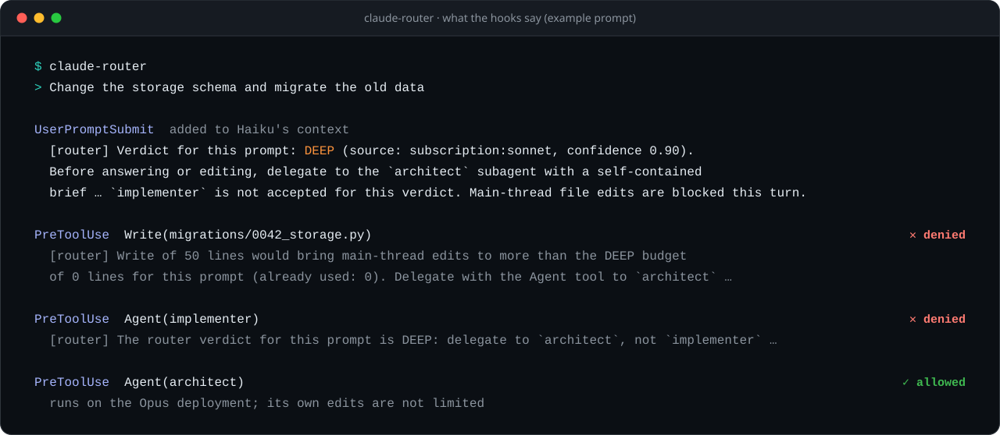

<div align="center">

<picture>
  <source media="(prefers-color-scheme: dark)" srcset="docs/assets/banner-dark.svg">
  
</picture>

<br>
<br>

[](https://github.com/analienx/model-router/actions/workflows/ci.yml)
[](https://github.com/analienx/model-router/actions/workflows/e2e.yml)
[](https://github.com/analienx/model-router/releases/latest)
[](LICENSE)
<br>


### Haiku does the easy work. A judge decides what is hard.<br>Sonnet and Opus get the rest, and hooks enforce it.

[Quick start](#quick-start) · [How it works](#how-it-works) · [Proof](#proof-it-really-works) · [FAQ](#faq) · [Setup guide](docs/SETUP.md) · [Changelog](CHANGELOG.md)

</div>

<br>

## Why

Running Claude Code on **Haiku** is fast and cheap, but Haiku is the weakest judge of when a task is too hard for it. Adding "use proactively" to an agent description is only a suggestion. And when you do escalate, **Sonnet and Opus are often rate-limited (429)**, so Claude Code waits minutes while it retries.

**model-router** makes "escalate when it's hard" something you can rely on:

| | Claude Code on Haiku | With model-router |
|---|---|---|
| **Who decides a task is hard** | Haiku, about its own work | A stronger judge (Sonnet), **before** Haiku starts |
| **Escalation** | A hint in an agent description | A verdict that **hooks enforce** |
| **Large edits by the small model** | Allowed | **Denied** above a per-tier line budget |
| **Hand-off to the right model** | Haiku may pick any agent, or override its model | Wrong delegates and `model` overrides are **denied** |
| **Opus or Sonnet throttled** | Retries while you wait | Retries capped, then **`deep-haiku`** at max effort, only after a real 429/529 |
| **Plain `claude`** | | **Untouched**: routing is on only through `claude-router` |

## Highlights

<table>
<tr>
<td width="33%" valign="top">

**A judge before every prompt**

Sonnet on your Claude subscription rates each new prompt FAST, STANDARD or DEEP. If it fails, Sonnet on Azure Foundry, then keyword rules, take over. When the judge is unsure, the task goes to the stronger tier.

</td>
<td width="33%" valign="top">

**Enforced, not suggested**

A `PreToolUse` hook counts Haiku's edited lines per prompt and denies anything over the tier's budget. It also denies the wrong delegate and any `model` override on a pinned subagent.

</td>
<td width="33%" valign="top">

**Built for rate limits**

The launcher caps Claude Code's retries. When `architect` or `implementer` really fails with 429 or 529, the same brief can run on `deep-haiku` at maximum effort, and Haiku is told to say so.

</td>
</tr>
<tr>
<td width="33%" valign="top">

**Fails safe**

An invalid config switches routing off and says why. Missing router code never blocks Claude Code. A hook error ends in a safe default, never a broken session.

</td>
<td width="33%" valign="top">

**Zero dependencies**

Plain Python 3.8+ (standard library only), plus Claude Code's own hooks and agents. Windows, macOS and Linux, installed for your user or for one project.

</td>
<td width="33%" valign="top">

**Proven on every push**

79 unit tests, and an end-to-end run of the **real Claude Code CLI** on all three operating systems against a local mock API. No model, account or network is needed.

</td>
</tr>
</table>

## How it works

<picture>
  <source media="(prefers-color-scheme: dark)" srcset="docs/assets/how-it-works-dark.svg">
  
</picture>

| Verdict | Who does the work | Model (your Foundry deployment) | Haiku may edit itself |
|---|---|---|---|
| **FAST** | the Haiku main session | `haiku` | up to 40 lines per prompt |
| **STANDARD** | `implementer` subagent | `sonnet` | up to 10 lines |
| **DEEP** | `architect` subagent | `opus` | nothing |
| *429/529 on the above* | `deep-haiku` subagent | `haiku`, max effort | - |

**Shortcuts that skip the judge:**
- start a prompt with `::fast`, `::standard` or `::deep` to choose the tier yourself;
- "yes" or "continue" keeps the current tier;
- "still failing" or "try again" moves up one tier.

### What the hooks say



<sub>An example prompt. The <code>[router]</code> lines are the hooks' own messages, shortened. The end-to-end test captures them from the real Claude Code on every CI run.</sub>

## Opt-in executable Opus-to-Haiku handoffs

Hard-task handoffs can now use a **machine-checked work package** instead of relying on instructions alone. `router/handoff.py` verifies the clean baseline and regression-first preflight, the edit hook enforces a narrow file allowlist, post-edit checks produce actionable retry/escalation evidence, and high-risk work requires a separate review attestation with fresh checks. A JSONL report tracks accepted work, retries, escalations and duration. This is off by default and does not change ordinary routing.

See the [executable handoff guide](docs/HAIKU_HANDOFF.md) for the schema, activation, commands, review requirement, and exact limitations.

## Quick start

**You need:** Claude Code (2.1.327 tested), Python 3.8+, a Claude subscription login for the judge, and an Azure Foundry resource with Claude deployments.

```powershell
git clone https://github.com/analienx/model-router && cd model-router
python -m unittest discover -s tests      # optional: 79 self-tests, no network
python install.py install                 # hooks + agents + launcher, for your user
# edit ~/.claude-router/router.config.json: Foundry resource and deployment names
python install.py doctor                  # checks everything, explains every problem
python install.py test-judge              # one real judge call per backend
claude-router                             # after adding ~/.claude-router/bin to PATH
```

**No git on the work machine?** Download `claude-model-router-<version>.zip` from the [latest release](https://github.com/analienx/model-router/releases/latest). The release also has `SETUP-offline.md`: the full guide plus the source of every file with SHA-256 checksums, for mail systems that block attachments.

The **[setup guide](docs/SETUP.md)** walks through every step on Windows, macOS and Linux: Azure roles, deployment names, `az login`, configuration examples, troubleshooting and uninstall.

> [!IMPORTANT]
> **Read before installing at work.** The judge sends each new prompt to Anthropic through your subscription, while the main session and subagents run on Azure. If your company requires Azure only, remove the `subscription` step from the judge chain ([guide, section 2](docs/SETUP.md#2-read-this-before-installing-where-your-data-goes)).

## Proof it really works

Every push runs both workflows on GitHub's runners. The results, reports and raw logs are public under [Actions](https://github.com/analienx/model-router/actions).

| Workflow | Runs on | What it proves |
|---|---|---|
| [**Unit tests**](https://github.com/analienx/model-router/actions/workflows/ci.yml) | Linux, macOS, Windows · Python 3.8 to 3.14 | 79 tests of the hooks, judge chain, guard, launcher and installer, with a fake `claude`. They include 27 regression tests from a code review (24 of them fail on version 1.0.0) and 3 from the end-to-end runs (2 fail on 1.1.0, 1 on 1.2.0). |
| [**End-to-end**](https://github.com/analienx/model-router/actions/workflows/e2e.yml) | Linux, macOS, Windows · Claude Code 2.1.327 | Installs the router into an empty home folder and runs the **real Claude Code CLI** through the `claude-router` launcher against a local mock of the Anthropic/Foundry API. |
| [**End-to-end**](https://github.com/analienx/model-router/actions/workflows/e2e.yml), latest | Linux · newest Claude Code release | The same test, as an early warning when Claude Code changes. It also runs weekly. A failure here is reported but does not fail the workflow. |

What the end-to-end test checks. Every check must pass for the job to be green:

| Scenario | Check |
|---|---|
| install | `install.py install` into an empty home folder writes the hooks to `~/.claude/settings.json` |
| DEEP | The subscription judge runs with every credential stripped, fails cleanly (the runner has no login), and the chain moves on |
| DEEP | The judge reaches the **Sonnet deployment**, with `judge_system.md` instead of Claude Code's system prompt and with no tools |
| DEEP | The main session runs on the **Haiku deployment**, and the hook injects the **DEEP directive** |
| DEEP | The guard **denies** Haiku's own 50-line `Write`, and the file is not created |
| DEEP | The guard **denies** handing DEEP work to `implementer` |
| DEEP | `architect` runs on the **Opus deployment** and is allowed its 200-line `Write` |
| DEEP | The background-agent notification is **not re-judged** (exactly one judge call) |
| FAST | A 5-line `Write` is allowed, and the next 100-line `Write` is **denied** (over budget) |
| 429 fallback | Opus answers **HTTP 429**, and `deep-haiku` is allowed and does the work on the Haiku deployment |
| safety | Plain `claude` is untouched, and with the router code deleted Claude Code is **not blocked** |

Each run's summary has the full report: 25 checks, with the hooks' output as evidence. The mock-API logs and captured hook inputs are under **Artifacts**. To run it yourself: `python tests/e2e/run_e2e.py` (see [CONTRIBUTING.md](CONTRIBUTING.md)).

> [!NOTE]
> **Not proven automatically:** a real Foundry resource, a real subscription judge call (CI runners have no login, so the test asserts that this step fails cleanly), and real interactive use. `doctor`, `test-judge` and your first session ([guide, section 6](docs/SETUP.md#6-verify-the-installation)) cover those on your machine.

## Configuration at a glance

The file is `~/.claude-router/router.config.json`. Every field is type-checked; if the file is invalid, routing switches off and Claude is told why.

```jsonc
{
  "foundry": { "resource": "my-foundry", "auth": "entra" },          // or api_key_env
  "tiers": {
    "fast":     { "model_id": "claude-haiku-5-5",  "deployment": "claude-haiku-5-5" },
    "standard": { "model_id": "claude-sonnet-5-5", "deployment": "team-sonnet" },  // modelOverrides automatic
    "deep":     { "model_id": "claude-opus-5-5",   "deployment": null }            // no Opus? DEEP -> Sonnet
  },
  "judge": {
    "chain": [
      { "backend": "subscription", "model": "sonnet", "effort": "max",  "timeout_s": 90 },
      { "backend": "foundry",      "model": "sonnet", "effort": "high", "timeout_s": 45 },
      { "backend": "rules" }
    ]
  },
  "guard": { "main_edit_budget": { "fast": 40, "standard": 10, "deep": 0 } }
}
```

All fields, with ready-made examples, are in [section 5 of the guide](docs/SETUP.md#5-configuration-reference-routerconfigjson).

## Tools included

| Command | Does |
|---|---|
| `python install.py install [--scope project --project DIR]` | Installs hooks, agents and launcher. Merges with your settings, backs them up, and keeps project files out of git. |
| `python install.py doctor` | Checks Python, config, Foundry auth, deployments, `claude`, hooks and agents, and explains every problem. |
| `python install.py test-judge` | Calls each judge in the chain once and prints the verdict, latency and errors. |
| `python install.py report --last 20` | Shows tier and source counts, judge latency, failures and recent decisions. |
| `claude-router --router-dry-run` | Prints the exact command and environment the launcher would use, with secrets masked. |
| `python install.py uninstall [--purge]` | Removes only the router's own hooks and agents, and never code another scope still uses. |

## FAQ

<details>
<summary><b>Does it change how plain <code>claude</code> behaves?</b></summary>

No. The hooks act only when Claude Code was started by the `claude-router` launcher, which sets `CLAUDE_ROUTER=1`. In any other session they exit at once. The end-to-end test checks this on every push.
</details>

<details>
<summary><b>How much does the judge cost, and how long does it take?</b></summary>

One `claude -p` call per new prompt. It carries the prompt (up to 6,000 characters) and a short rubric, with no tools, no CLAUDE.md and no hooks. Follow-ups such as "yes" or "continue" skip the judge. On your subscription the call counts toward your plan's usage; on Foundry it is billed per token. The timeouts are 90 s for the subscription judge and 45 s for Foundry, and both can be changed. `python install.py report` shows your real judge latency. Details are in [section 10 of the guide](docs/SETUP.md#10-cost-and-latency).
</details>

<details>
<summary><b>What happens if the judge is down or slow?</b></summary>

After an error or a timeout, the chain moves to the next step. The last step, keyword rules, always answers. If you remove the rules step and every model fails, the prompt is routed up to STANDARD, not down.
</details>

<details>
<summary><b>What happens when Opus is rate-limited?</b></summary>

The launcher caps Claude Code's retries, so a 429 surfaces sooner instead of after minutes of waiting. When `architect` or `implementer` fails with 429 or 529, Haiku may run the same brief with `deep-haiku` (Haiku at maximum effort), and it is told to say that the result came from the fallback. The guard allows `deep-haiku` only after a real 429/529 for that exact call. The router's own text, ids and file paths never count.
</details>

<details>
<summary><b>Can Haiku get around the guard?</b></summary>

Not through Claude Code's edit tools (`Edit`, `Write`, `MultiEdit`, `NotebookEdit`) or the `Agent` tool: those are all checked. Commands run through Bash (`sed`, redirects) are **not** inspected. The router is a routing layer, not a sandbox; use Claude Code's permission settings to restrict Bash.
</details>

<details>
<summary><b>Do I need Azure Foundry?</b></summary>

The launcher targets Azure Foundry today. The hooks and agents are provider-neutral, so a launcher for Amazon Bedrock, Google Vertex AI or the Claude API would be a welcome contribution.
</details>

<details>
<summary><b>Where does my data go?</b></summary>

The judge sends the new prompt, the folder name and, optionally, the git branch and the count of uncommitted files to Anthropic through your subscription. Everything else goes wherever your Claude Code session goes. By default, the decision log stores a hash of each prompt, not its text. See [section 2 of the guide](docs/SETUP.md#2-read-this-before-installing-where-your-data-goes) and [SECURITY.md](SECURITY.md).
</details>

## Limits

These are stated plainly; details are in [section 12 of the guide](docs/SETUP.md#12-limits-and-known-gaps).

- **File changes made through Bash** (`sed`, redirects) are not inspected; only Claude Code's edit tools are.
- **For a DEEP question that needs no edit**, Haiku is *told* to ask `architect` but can't be forced to. Which agent it delegates to *is* enforced.
- **The judge only sees the prompt**, so a task that turns hard halfway through is caught by the edit budgets and by "still failing" escalation, not by the judge.
- **The launcher targets Azure Foundry today.** The hooks and agents are provider-neutral, and other providers are a welcome contribution.

## Project layout

```text
router/     judge_hook.py · guard_hook.py · launch.py · common.py · judge_system.md
agents/     architect.md (Opus) · implementer.md (Sonnet) · deep-haiku.md (Haiku, max effort)
install.py  install · doctor · test-judge · report · uninstall
tests/      79 unit tests · e2e/ (mock API and a runner for the real Claude Code)
docs/       SETUP.md (the full guide) · assets/ (README images)
scripts/    build_bundle.py (offline zip) · build_assets.py (generates docs/assets)
```

## Contributing

Bug reports with `install.py doctor` output are the most useful. See [CONTRIBUTING.md](CONTRIBUTING.md) for the development setup, the test suites, and the rule that every bug fix ships with a test that fails without it. For help, see [SUPPORT.md](SUPPORT.md); for security issues, [SECURITY.md](SECURITY.md). Everyone taking part follows the [code of conduct](CODE_OF_CONDUCT.md).

## License

[MIT](LICENSE). Not affiliated with or endorsed by Anthropic or Microsoft. "Claude" and "Claude Code" are trademarks of Anthropic; "Azure" and "Microsoft Foundry" are trademarks of Microsoft.

<div align="center">
<br>
<sub>If model-router saves you a wait or a wrong edit, a star helps others find it.</sub>
</div>
